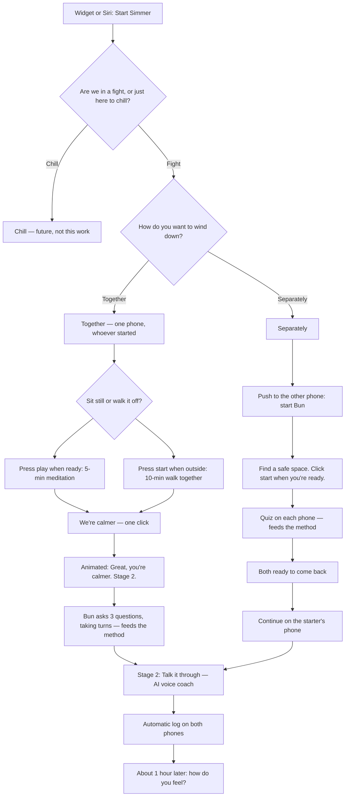

# Simmer app flow design: fight mode, wind down, and reunion workflow

- **Date:** Thursday 12 November 2026 (PT)
- **Participants:** Tyler Donahue (listed). A second speaker is present throughout, walking through visual designs and making flow calls. The dialogue uses "Irina" / "Irina with Bun"; treated here as Iryna. No last name or role is recorded.
- **Source:** pasted transcript, shared with Tyler's Simmer bot on 12 Nov 2026
- **Filed:** 12 Nov 2026, ~6:40 AM PT, by Tyler's Simmer bot
- **Complete?** No. The transcript ends mid-sentence: "How do we then work on this? Well, first thing, just"

They were looking at visual flow screens (open screen, Siri lock screen, the red fight-or-chill screen, wind-down steps, sit still, walk it off, come-back). One speaker needed the flow visible, not only talked through. They agreed to finish the full workflow in conversation, then have AI update it. Chill mode was explicitly taken off the table for this work.

Speech-to-text in the transcript is noisy (`paws` = pause, `series` = Siri, `pipe` = fight, `Bon`/`Ban` = Bun, `Bardner` = Partner, `lock window` = log window, `work comer` = we're calmer, `sit still` / "dynamic is walk"). The sections below use the intended meaning. The Transcript section is verbatim.

## Decisions

1. **Launch is both a home-screen widget and Siri.** One widget button starts the app. The word is not "Pause"; Tyler will choose the wording (his task). "Hey Siri, Start Simmer" is the other path. Both are kept.
2. **Siri may still show a lock-screen "Open Simmer or Stop" prompt.** They want it to unlock and go straight into the app if possible, but will keep the current lock-screen design until that's proven. "We can see if it can do it without that prompt."
3. **On-screen start and Siri start are the two first-open options**, then the app goes to the fight-or-chill screen (the red screen). That fork stays.
4. **Fight/chill supporting copy can be changed later.** It is not the core workflow and should not block this work.
5. **Chill mode is not the current focus.** "This is in the future. Period."
6. **Cut the text.** Screens in a fight are too wordy. Together-or-separately should be two clear options, with a short voice line (along the lines of "Hey, what's up? It's Bun. How do you wanna wind down — together or separately?").
7. **One subscription, partner joins free.** In Together, they use whoever's phone started the session (widget or Siri). Shared context is stored so both phones have the same history.
8. **An automatic fight log is a core part of the product**, not a nice-to-have. Generated after every use, resolved or not: "Simmer was used. Here's the summary." Visible any time from a menu. Search by date and topic; intensity (for example, it got heated) can be inferred later from voice tone. Precise wording and commitments have to be stored so later chill-mode reflection works. This is meant to replace messy personal Apple Notes.
9. **Mid-week "direct to log" (log a feeling when you're not in a fight)** is useful but **not now**.
10. **A one-hour post-fight follow-up is the direction.** After a fight, both partners get a short quiz: How do you feel? Calmer? Was it resolved? If not, why (unheard, still hurt, …), with a way to write more, postpone, or say "no feedback, it was all set." Both completing it finishes that fight's history. A lighter alternative was also liked: a push ("Want to reflect on the last fight?") that opens a Chill reflect option. Not the design focus of this meeting.
11. **Together vs Separately is the first wind-down choice, on its own screen.** The next choice is not on that same screen.
12. **If Together:** a new, clear window to pick **Sit Still** or **Walk it Off**, with a short description of the time.
    - Sit Still: "Press play when you're ready" → **5-minute** recorded meditation (breathe in, breathe out). "Five minutes is enough."
    - Walk it Off: they walk **together** (not two separate phones). "Press start when you're outside" → **10-minute** timer. Around minute 3–4, a suggestion can pop up on screen (for example, "Name three things you can see out loud"). Do not auto-start the timer; they press start once they're outside.
13. **If Separately:** the other partner gets a **push notification** to start Bun. A new window: **"Find a safe space by yourself. Click start when you're ready."** Then the quiz. Title the screen like "Tyler with Bun" / "Iryna with Bun". Don't say "separately" again. **Three of five questions is enough.** Voice or text, same questions. The questionnaire itself still has to be written.
14. **Step / progression indicators are liked** (they show where you are) **but are not the focus right now.**
15. **Both paths reunite at Talk it through.** Together comeback and Separately comeback are different screens.
16. **Together comeback is one phone, one click.** "We're calmer" / collective ready. No dual check-in. **No extra Start button.** An animated beat — "Great. You're calmer. Let's start stage two. Talking it through." — then the AI voice opens by itself.
17. **Separately comeback:** after both finish the quiz, "I'm ready to come back." Both tap ready (e.g. Alex ready, Sam ready), then Stage 2.
18. **Talk it through must be in the design flow**, all the way to close. It opens the AI voice coach. A chat window with a small voice animation; spoken messages may fade, leaving a short visible tail.
19. **After Separately, Stage 2 continues on one phone: whoever started the session.** Do not ask "whose phone?" — that can itself start a fight. The starter's session / user ID is carried through, and the other phone is not the Stage 2 driver. "It's not complicated."
20. **Less to do, fewer buttons.** Together wind-down is **only a timer — no quiz**. After "We're calmer," Bun asks **three questions, one by one, taking turns** (e.g. Tyler first, then Iryna). Those answers **feed the method**: Bun then suggests an exercise. Separately, **the quiz is what feeds the method**.
21. **The Separately quiz must be different from Together's three spoken questions.** Choosing to separate is a more intense state and should not be treated the same. Clicking Separately is itself data that informs the method, along with the quiz answers.

## Agreed flow (not built yet)



Subscription and history: Partner 1 is subscribed, Partner 2 is invited free. Shared conflict history lives in a context library on both phones. In Together, only the starter's phone is in play. In Separately, both phones are active for the quiz, then Stage 2 resumes on the starter's phone.

## To-dos

From this meeting (design and product; not yet in the live app):

- [ ] **Choose the widget button wording** (not "Pause") — Tyler
- [ ] **Add a window after Together:** Sit Still vs Walk it Off, with a short description of the time
- [ ] **Add a Separately window:** "Find a safe space by yourself. Click start when you're ready," then the quiz. Title like "Tyler with Bun"
- [ ] **Revise the Walk it Off timer:** press start when outside, 10 minutes, suggestion pops up around minute 3–4
- [ ] **Unify the Together come-back** into one "We're calmer" / collective-ready screen (one phone, one click), then auto-advance to Stage 2
- [ ] **Add Talk it through to the design flow** through close (voice coach, chat window, voice animation)
- [ ] **Write the Separately questionnaire** (voice or text, same questions; 3 of 5 is enough; different from Together's three spoken questions)
- [ ] **Together Stage 2 opening:** three spoken turn-taking questions that feed the method, then a suggested exercise
- [ ] **After Separately, auto-resume Stage 2 on the starter's phone** — no "whose phone?" prompt
- [ ] **See whether Siri can skip the Open / Stop prompt** and go straight into the app
- [ ] **Shared history in the menu:** automatic summaries, search by date and topic; exact wording and commitments stored
- [ ] **One-hour post-fight reflection** (short quiz for both, or a lighter "want to reflect?" push into Chill)

Parked or later (do not treat as this meeting's build list):

- Chill mode (future)
- Mid-week direct-to-log of feelings, for weekly check-ins
- Step / progression indicator UI (liked, not the focus)
- Intensity ratings in the log (possible later, via tone)
- Updating the live app and `FIGHT-MODEL.md` to this flow — they asked to define it first; implementing it was not the ask when this was filed

The transcript cuts off at "How do we then work on this? Well, first thing, just" — there may be more to-dos that were not captured.

## Open questions

- Can Siri bypass the lock-screen Open / Stop prompt?
- Final widget button label (Tyler's task).
- Exact copy for the new windows (safe space, we're calmer, sit still vs walk it off).
- The Separately questionnaire content, and how it differs from Together's three questions.
- The exact three questions Bun asks at the start of Together Stage 2 — not written in this meeting.
- One-hour follow-up quiz vs. the lighter Chill-reflect push: both were liked; which ships first is not locked.
- Whether completing the follow-up is required before a fight's history is "complete," or postpone / "no feedback" is enough.
- Log UI details beyond "it's in the menu, search by date and topic."
- How two-phone push and session-ID handoff actually work — agreed in principle, not built.

## Transcript

The pasted transcript follows, verbatim. It ends mid-sentence.


*(Transcript ends mid-sentence.)*
```
Me: So we agreed to have one button as a widget maybe not the word pause, something else over there. I I will think about the options. Maybe let it be my task to do. And then we either have the widget starting the app, or can we have the Siri starting the app? Hey, Siri. Start simmer, and that opens up the application. Yeah. We could have both both work. Great. So let's have that as options. And then we don't have this second screen that is is talking, or this is the lock screen? Both of... This is open screen, and this is lock screen. When series starts. Well, yeah, this is, like... This would be if you start with Siri. Okay. Great. And this would be if you start on screen. So if you said, hey, Siri, start timer, it would show up the lock screen. And it would say open simmer or stop. Can we just have it like, unlocking the screen and going into the app? Maybe. Sometimes Siri forces you to click approvals, but maybe we can bypass that. Well, let's keep it this way then. Can series start a widget Well, it can jump you into a specific point of the app, but like, a lot of times, I think it... It's gonna prompt you like this to open similar stop, but Okay. We can see if it can do it without that prompt. Fine. So these are... If I understand correctly, this is our open first option. This is our open second option. With the voice or with clicking the button. Yeah. Yeah. Cool. This is how it starts. We then jump into the page where it asks, are we in a fight or just here to chill? Okay. I think we can just remove this word here. One helps you both to cool down first, check ins, patterns. Or to clarify what does that... Because it's a little bit unclear right now. What do you think? Yeah. Yeah. I mean, that that that copy to me can be changed later I don't think that's... I think we're trying... In general, that's not affecting the core workflow. If we wanna start start start... Yeah. Sure. Then was mom's got you? So right now, we have two... We have three stages. Like, if I imagine, it's speaking now. Instead, but there's some things on the screen. Bun's like, what's up? Do you guys wanna do this together or separately? And then you prompt, then you can, like... It can say click one of the screens. Does it appear one by one or all of this we have on the screen? However, I mean, I guess, however we want that interface to be. And, like, this can be, like, you know, like a voice saying, like, hey. What's up? It's Bon. Yeah. And then, like, there's two prompts below. How do you wanna wind down? Do you wanna do it together or do you do it separately? Yeah. Okay. Yeah. Just like option number one, option number two. Alright. I would like, to have the clarity of the screen, I would make it more simple in amount of the text because this is a little bit overwhelming. Right now. Mhmm. It's it's a lot to read. And definitely too much during a fight. For sure. And this is a good button, but maybe, like, later or a little bit less. Yeah. Yeah. Obviously. More. Yes. And this is also... Okay. So the flow stays like this. Yes. We are in a fight mode. I just wanna see it here. We are so this is this or... No. This is the red screen. Right? Here. Fight or just here? Yeah. Yeah. That's the red screen. Are we in a fight or just here to chill? Cool. And so then it's either we're in a fight or just here to chill? Mhmm. And then we have this paws, which here is wind down. Right? So maybe I would just, like, adjust the flow so it has the same freezing? My thyroid is up. Because it's a little confusing to me. I The what? What is here is not what is here. What kind of is?... Confusing. So scroll over. Wind down. Step one. Wind down. Step one. Okay. But, yeah, sure. We can make that workflow more clear. So that's what we're defining now. Down But right now, here, what is lacking is together or separate Okay. Because it says both ready. Yeah. Yeah. We can... Let's work on... Let's define what we want here so it records, and then we can have the AI up the workflow afterwards. Unless you wanna pause and update the workflow now. But that that is the whole idea to update the workflow. But I but I wanna finish I wanna finish talking to the full workflow and then have AI update it. Are you saying you wanna stop now and update workflow? No. At Tiers? No. It's okay. We can have AI update it. Cool. In pipe or just here to chill? Okay. So pipe or chill mode. We got that. I need it visually. I cannot just talk through it. That's why I'm struggling. Need something visual to see things. That's why I'm trying to write it down. So if we are gonna fight if gonna here, one helps you to cool down first. And then we are either So it's cool down. I'm just using the restroom. And then we are either together So if I understand correctly, the chill part right now is not something that we're focusing on. No. This is in the future. Period. Question here. When we are in the cool down together mode, how does it work with the phones? So we have one person subscription. Correct? And the partner the partner is for free. That's why I imagined it. That's why I imagined it. So Bardner won subscribed. And partner too is Right. Invited. If we are in the space together. And they decide here... They click together. Whose phone they are doing ban on. Whoever doesn't. First. Right? Whoever is the one who clicks whoever says, hey, Siri, start button or clicks the widget. Okay. And then then it just automatically updates for the other one? Yeah. I think that there's shared context. So, like, every every conversation that one has happens on one phone, the context library is stored. So it tracks conflict Like, oh, you you had this conflict. The way, I realized you're having a similar conflict. You had same one on October 2. Here's how it was resolved. Yeah. So there should be, like, a log Uh-huh. Some kind of log that is clear also, and it's like, a lock window. Or something like that. I don't know if the log window needs to be something typed. I think the log window can be generated automatically. Right? Because if if it guides you enough, well through voice, it each person will come at at the end of this with some resolution. And they'll explain what they want from the other parter. From the other party or how they felt. Okay. Well, that's in the case that they resolved. What is the case that they don't resolve? They just need to have a lock anyways. Yeah. So there... They can, like, go back. Like, log of when simmer was used Yeah. Yeah. So I think that's all... Happens automatically. Like, simmer was used. Here's the summary. Happens automatically, but what is the window where you're able to see the logs I think that you could see the log at any time. Yes. But where is the window? You see that? Where on the menu in the functionality is that place that you can go to and see Like, pass logs? Was the... Yes. Pass logs of the conversations. Yeah. I mean, I imagine it just, like, like, there's, like, a little like, menu button. Right? There's blogs. Yeah. But I'm just saying that it has to be in the menu. Yeah. So you can insert... You can search by data... Search by date? Yeah. Search by dates, search by topic, By date. Topic, mean, you could rate the intensity or something. No. And there's a bunch of stuff we could do there. Alright. Because voice models are getting really good at handling understanding like, tone. So if, like, we're yelling at each other or they're yelling at each other, it can note that as, like, you know, it got really heated. Mhmm. Yeah. I just wanted to double check that we are seeing the history. And whenever in the chill mode, they go back to analyzing, they can still pull up the history of what was happening and talk about analysis. Mhmm. Because, for example, what I did after we had the conversation today with Chad, I went into Chad and I asked what was the commitment that I made yesterday. And did I promise on because if I remember correctly, I promised on writing down some of the criticism and then discussing it later. Mhmm. I didn't do, and it didn't track it. And I don't have any log And I would like you see what was the formulation that I used yesterday. To understand what exactly I committed to and ask whether I was in line with what I promised or I wasn't. Mhmm. Mhmm. This is kind of like the chill training exercise that I was doing on the side the final. That's good. Yeah. Like, self reflection. But it has... It needs data, and it has to be, like, like, precisely stored somewhere. Yeah. Yeah. So that they're... Like, what you said and what I said is tracked down. Oh, yeah. For sure. I think this is a huge component of this app is the fact that it's tracking all of for you. Yes. Alright. So imagine we are in a fight. Partner one has subscription. Partner two, for example, started the app. It's gonna be the same for both. And it's gonna be logged on both of the phones. They have a shared history of fights. Correct? Yeah. I wonder if there's also, like, a direct to log thing, like, you're on chill mode or alone. You say, like, I'm currently feeling very this after this interaction, and it's not like we're in a fight, but, like, want to express how you feel instead of us doing it in our notes, like, at our weekly check-in it can be, like, hey. This is the this is the way we're in the field throughout the week. Things they address during weekly. Kind of thing. Like, is there we don't need to do this now because I know we're focused on this one workflow, but it might be useful to be able to log because sometimes it comes up later, not during our conversation. It can have an automatic follow-up one hour afterwards. Mhmm. Okay. Is there anything... Do you wanna log how you feel about this? How about, like, one hour after, can this button have, like, a timer Once it stops, it's gonna, like, calculate the amount. After And then there will be, like, a question and the prompt that gonna go on the screen, log how you feel or, like, answer these why I wanted to show you. There was, like, a quiz It's like a big window. And after the timer, it can be like a quiz after you triggered simmer. One hour afterwards. How do you feel right now Calmer. Mhmm. Do you feel like what we discussed was resolved? Yes? No? No? Why... Like, what are the things that you felt unresolved? I was unheard I still feel hurt and emotional. Like, nothing makes sense or, like, I don't want to continue this relationship or I don't know. Like, three buttons. Mhmm. And you, like, answer a test that helps to log how you felt afterwards. And if you have something unclear, if there is, like, a thing that they would like to say you click on it, you tap, and then it prompts you back into a page of the app where you write feedback. Mhmm. And it's stored in the long of the fight. Mhmm. As, analysis afterwards. Yeah. It prompts both to do it. And maybe if one did that, the other one also has to do it. They can put postpone, but it's gonna coming up, and you will not be able to like, go into resolution unless both gave their feedback. Yeah. Or I or or you could say, like, don't have any feedback. Like, it was all set. Yeah. Okay. So, like, this test has to be completed for the whole history to be, like, Yeah. Completely Logged for that fight. So it's, like, fight date, And then in the log, there's recording from the conversation or data from the separate conversation. Yes. Or instead of creating all of that because it's a lot of tasks, you can just go into chill mode and, like, have an option reflect back on the last conversation that was on. It's good that too. And, like, a free window of just, like, But, I mean, a push notification that's like, hey. Do you wanna reflect on the last fight? Yeah. Because right now, like, basically, what we're doing is we're each storing at our own Apple Notes. Yeah. And we're like, reflecting our own bites and just kind of stored there. But it's not organized by date and fight. So it's like A mess. Yeah. Okay. Now if we are together, we have we have come We're, like, still way more dynamic. And still way is meditation. Sit still. And dynamic is rock. This so I I would like to have another window where it's like you just choose first together or without, like, text The next one explains to you It explains to you why you don't have these buttons, for example. Yeah. Yeah. Sure. So when like, this text to school. I just don't want to have options, so it's overwhelming. Then the next window, when it's together, you would select in between the two, sit still or walk it off, like, and it's a clear window. Cool. And then when it's separately you just click click Mhmm. And Maybe here, you don't freeze already like this. You wanna show this stuff? Soon. Steps. Yeah. I like showing steps, but You like it? Yeah. I think it shows progression. Like, where are you in in the in this, like, dialogue? We're in step one of the dialogue. It just seems... The reason for why I'm asking whether we need this because it seems, like, too long. It's still, like, one, two, three, four, five, It's, like, or maybe... No. Okay. Let's not focus on it right now. So separately, BUN gives you like, questionnaires. Yeah. Yeah. Some type of prompts to Okay. I'll think then one more step is for us to work on the questionnaire. For sure. Yeah. That's another part to work on. I'm fine with working on it. Okay. So This one can be a meditation that is recorded. Breathe in, out, and all this Mhmm. Kind of jazz. So that it's prompted. Cool. And now we'll start at this five minutes. Yeah. Great. Five minutes is enough. And then so... Okay. So then server side no talking about it yet. So this is together, walk it off. Together, sit still. Okay. So this is when you're walking Or... Yeah. I mean, what... How does it look It's just the same way. Okay. Yeah. And then it, like, pings you when it's ready to reconnect? I actually like the idea that is here, but can it just, like, pop up on the screen like a suggestion? What do you mean? What what Name three things you can see out loud is fine. Like, let's say on the third or fourth minute Mhmm. When first of all, the timer needs to start when they are outside. So there needs to be some time that they go out Or we need to... Or the timer needs to start. Give a grace window for them. To get that. Or this timer needs to be started when they are outside. Well, the problem is is then that's another thing for the user to do. So the user just started it. They're together. And then cool. Walk it off. You go. And then it's like, you gotta But it just needs, like, start. For both when they selected So Got it. So there was a window where it was, like, together, sit still, together, walk it off, and you decide between the two. And you click sit still, it then prompts you to a new window. Where you have this with the like, just look at each other Press play when you're ready. You press play. The timer for five minutes starts. Same thing here. Press play when you're outside. You press play. Press start when you're outside. You press start, and it's starts the ten minute time. So if it's... So if you're separate... So if if you say walk it off, then the partner who who didn't start the app on the first place. We bought the first together. Yeah. Well, it gets... Well, I think you get a push notification. Probably because you need to enter the state. Because if I if I start it, hey. There's a notification. We're here. And we say, walk it off. Now both of our phones need to be activated and walk it off. Right? Right. We're together. But if we're walking it off? We are together walking it off. Oh, got it. Okay. We chose together. Mhmm. Got it. Got it. Okay. Cool. They're walking it off together. Got it. You press play. Mhmm. Got it. And so together is... Okay. Got it. And separately, it would be a different Separately is a different way. Separately is this talk Got it. Got it. Okay. Cool. Great. Alright. Makes sense. So separately, that's when a push notification starts. If you click separately, then automatically whoever started it has it on their screen, but then your phone gets a push notification Yeah. And you Start your bun. Yeah. Right. Yeah. And then separately, I would maybe, like, together... Yeah. Okay. Separate... Separately, fine. I would then make this window be, like, like, you're on your own, you're safe. Something like this. Know. Whatever. Or no even... Like, Alex with Bun. Or Tyler with bun, Irina with bun, just that. Mhmm. Yep. Three out of five. It's enough. We don't need to mention again that it's separately. Okay. Then this questionnaire, we need to work on the questionnaire. And there is also an option to have it with voice, but it's the same questions. Right? Yeah. Yeah. Sure. Okay. Cool. Cool. Ten minutes are up. Ready head to head back. Ah, okay. But here you had, like, instead of the chat, you also had to walk it off? Yeah. Regardless of how you end up back to... Like, this screen, even if you do it separately, you come back together here. Like, walk... Okay. You did it together. Cool. Time to come back. Or you did a separate. Cool. Time to come back. And, like, then talk it through. It starts. Separately, one down down. This is after the test. Because After the quiz. So that when the quiz finished, Mhmm. You it's it's asking, I'm ready to come back. Oh, yeah. This is this is the separate comeback, and this is the together comeback. Okay. Where did you come back? Together? But when we are together, we only have one phone. Mhmm. So we don't need both to check-in. We could do... We're both ready. Ready to come back. Like, Mhmm. Yeah. It was just click ready. Mhmm. Or, like, walk done. Okay. Yeah. Yeah. Being collected ready. Yeah. Talk it through. Collective ready. Yeah. Mhmm. Start stage two when you're just start stage two. Yeah. Okay. Alright. Where's is it not get this issue yet? I don't think it's as designed. Past the one down yet. Lock it through? Yeah. But I think we don't need to design talk it through. Talk it through opens the AI voice code. But we still should have our windows here so we understand the full progression in one place. Yeah. The soonest Which windows? Like, talk it through. Cool. Opens voice mode. And then we see that there's voice mode after come back together. So that there's a full progression in our Windows till till close. Yeah. Yeah. Don't we don't just wanna not have that in our design flow. Yeah. Yeah. No. We need it in the design flow, and then there's a window with fun, but it looks like this. There's just, like, chat. Yeah. Or or just... It has a little button voice animation. Right? It's like a little button talking. Yeah. Yeah. Yeah. Maybe, like, when I'm talking in the little window where the message is, like, kind of vanish. Evaporate. Like, you see the first three Sorry. I'm... I've been having Okay. Okay. So there are a few windows to add. We need to go through the quiz that simmer... That bun is doing during the separate window. We need to change the window that is a timer when we're walking together. And we need to change the window when we are ready to come back together reunite it into one because it's only one partner that's controlling the phone. We need to add one more window after we decide whether we are doing the wind down together or separately. To clarify if we are doing it together, which way we're doing it, sits still or walk it off. That describes shortly what's gonna be the time spent. Or separately where we are also deciding whether it's not Separately, we just click and it all prompts to open the app. Mhmm. It it first suggests to find the safe space We we can also have it as a start button. It says find the safe space by yourself Click start when you're ready. And then you click start, and you start your chat. Here. That is the quiz. Separately. Yeah. That's separate. Exactly. Mhmm. What I was saying is when you click separately, it opens up the window that we need to add. That will have find the safe space by yourself Got it. Click start when you're ready. When you're finding the space, you click start, and then the quiz opens up. Great. Good deal. I like that. That's it. I Then the next stage is talk it through. Start stage two. So when we are both done with the quiz, then it makes sense to have ready to come back together this window. Comes in. Alex, ready. Sam, ready. You both click start stage two. This is the question again because talk it through is gonna open and AI coach. We have ten minutes, by the way, so we need to wrap it up. It starts the AI voice voice coach. Now we have two phones again. So we need to somehow prompt to use one phone. Yep. So maybe we need to, like, select whose phone we're using. And then we are going to a one person user of the phone and a chat window. Where we have an immediate button So when you come back, you're deciding what the master phone is, one driver after the other. Yeah. Okay. So there's some, like, prompter window that says, okay. We're using telephone. Yeah. And then and then it fell, like, I guess the easiest way to do that would be yeah. I'm using my phone. I'm not using my phone. So, like, we're just, here. Okay. I'm using my phone. It starts there, and you say, I'm not using my phone. Both can click. It also can be a reason for five. This also can be a reason for a fight. What? Whose form are you using? Does it matter, though? I don't know. For some people, it might matter. Can it just automatically switch off one phone? Accuse it of the wireless phone Donorina's phone. Mortgage continue whoever started it. Automatically. See whoever prompted it. You can continue. On that phone. How is gonna understand? If you look at, like, a complicated feature? Because you then switched to using two phones. So they're complicated because there's a user ID a session ID, for the person. So partner one Tyler. Has a session ID Like, a user ID. And so when they start the session, that information is carried throughout this whole thing. As time they're starting the session. And so it can... It knows that, and it can... And can direct to say, hey. Remember what who started the session and automatically if they decided to go separately, automatically resume the person who started the fun to continue on their phone. It's not complicated. Alright. If you're able to do it, then you say it's not complicated. So then it pops up the window of chat. And it's the stage two, talk it through. For the talk it through, there is a way in which it has the style of communication. It can ask again, talk it... Talking it through one by one if we agree to discuss what happened, if we want to dive into the recurrent pattern, or we want some suggested exercise based on the things that we filled in when we were separate. Or or we Or we need another quiz. If we were together. Because how then it's gonna start a specific exercise if it doesn't know which kind of exercise to do? Based on the case. If the exercise is fed by whatever was being prompted. During the wind down time. You mean? Because, like, separate has a quiz for wind down time, but together doesn't. Yeah. Mhmm. So maybe together, needs a quiz as well. And and regardless if you're together or separate, it it kicks off both devices. I like the idea of prompting more things to do. Kicking out two devices is more things to do. Having another quiz is more things to do. It needs less things to do. Less buttons to click. So if you're together, then it's just a timer, and there's no quiz? If we're together and we click, we're calmer. It can prompt AI and ask questions one by one. It can, like, work together. We're calmer. We're calmer. What what if... When when we click work comer, can it prompt us to stage two automatically? Sure. So we can just go from we're calmer to, okay, create your calmer stage to talk through. Yeah. Right. Like, click start. We click start, or it just has, like, or it just has, like, a second, you know, like, a animated kind of a thing. We're calmer. It's like great. Stage two. Talk it through. It just opens up by itself because when you click, we're calmer, we're ready talk it through. There is no need to click another start button. Mhmm. So when we're calmer, what opens up, it's like a animated screen. Great. You're calmer. Let's start stage two. Talking it through. And then it slides and the eye voice opens up. Hey. I'm Bun. How do you feel after the fight? Answer these three questions for me, please. Tyler, go first. Blah blah blah blah blah. You answered. Irina, what do you feel? Blah blah blah blah blah. Great. Question number two. Tyler, you go first. Blah blah blah blah blah. Three questions. Great. Based on this, I suggest we do exercise I'm angry. Bye. One by one. And it prompts based on these three questions. That's what we start. Yeah. Yeah. Yeah. So it creates a channel of, like, of a method. It creates the method based off of the first three questions. So that would mean separately we don't need a quiz. Either. Separately, we need a quiz That's the quiz separately. Got it. That's what feeds the method. Yeah. Got it. So on separately, you feed the method on your own with each of your own devices. And when you come back together, And and when you're together, you feed it together. Yeah. When you're done when you're done. Cool. Yes. But when I would then next time focus on whether when we are separately we have some kind of quiz that is different from when we're together. And we're coming back. Because I would imagine that's a different state. They should not be treated equally. Sure. Because when you want to be separate, it's more intense. Yeah. So I don't think it's gonna be the same quiz? That's good to know. Because, yeah, the fact that it's separately is feeding the method anyway. Like, you decide to do separate then What do you mean by feeding the method? So when we say together or we say separately? The AI is storing that information. And it's deciding how it's going to support the users. Right. When you say separately, per your point, that is information. And the information that that is is it's probably pretty intense if they don't want to be together. Such that it's feeding whatever method it decides to come up with along with the quiz answers Taking the fact that you clicked separate as piece of information data to to design the method. Yep. Yeah. Okay. How do we then work on this? Well, first thing, just
```

*(Transcript ends mid-sentence.)*
